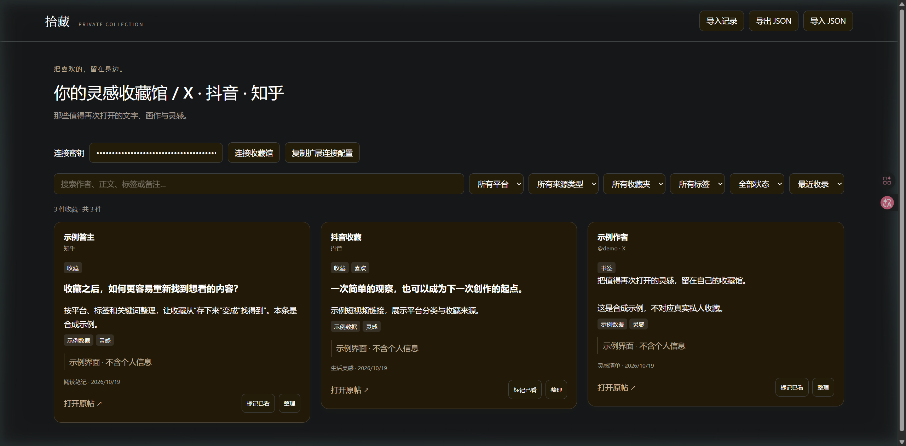

# 拾藏 Shicang

把 X、抖音、知乎里收藏过的链接，整理进自己的本地收藏馆。

**[下载 0.2.1 正式版](https://github.com/konghenfuxue-cpu/shicang/releases/latest)** · [安装教程](docs/usage.md) · [采集方法](docs/how-it-works.md) · [更新记录](CHANGELOG.md) · [问题反馈](https://github.com/konghenfuxue-cpu/shicang/issues/new/choose)

Python 标准库 + SQLite + Chrome/Edge 扩展，无第三方 Python 依赖。扩展在你已经登录的网站页面上读取可见内容，预览后由你确认入库，数据保存在本机。

> 当前正式版采用手动扫描，尚无定时同步、自动登录或全历史完整性保证。下载包是可运行源码，**不是 EXE 安装包**，需要先安装 Python。

## 界面



截图使用合成示例数据展示真实程序界面，不包含个人收藏或账号信息。图中的深色由浏览器显示扩展呈现；收藏馆原生样式为浅色，采集面板内置深浅色切换。

## 能收哪些内容

| 来源 | 当前支持 | 操作方式 |
| --- | --- | --- |
| X | 书签、喜欢 | 在对应标签扫描，滚动加载 |
| 抖音 | 收藏、喜欢里的视频/图文链接 | 在个人页选中对应标签，滚动加载 |
| 知乎 | 单个收藏夹里的回答、文章、想法、视频链接 | 打开收藏夹内容页，自动翻页 |

- 收藏馆按平台、来源类型、收藏夹、标签和已看状态筛选，支持搜索、备注和标签编辑。
- 同一平台内容按 ID 去重；既收藏又喜欢的内容保留两种分类，只生成一张卡片。
- 采集面板支持浅色/暗色、随时停止、JSON 导出和继续扫描。
- 保存来源链接、可见标题/摘要和远程封面地址，不下载媒体或完整正文。

## 三步开始

前提：Python **3.10+**、Chrome 或 Edge。请确认终端运行 `python --version` 能显示版本。

1. **下载并启动。** 从 [Releases](https://github.com/konghenfuxue-cpu/shicang/releases/latest) 下载 `shicang-0.2.1.zip`，解压到固定目录，Windows 双击 `Start.cmd`。服务会自动打开本地收藏馆；保留启动窗口。
2. **加载扩展。** 打开 `chrome://extensions` 或 `edge://extensions`，开启开发者模式，选择“加载已解压/未打包的扩展程序”，选解压目录里的 `extension`。在收藏馆点击“复制扩展连接配置”，粘贴到采集面板的密钥栏后保存，地址会自动填入。
3. **扫描并保存。** 打开已登录的目标网站收藏内容页，点击拾藏扩展图标。先扫描 2～3 轮，点击“检查新增”，确认后提交。刷新收藏馆查看结果。

完整步骤、三站入口与常见问题见 **[安装与使用教程](docs/usage.md)**。

其他系统可尝试 `python3 server.py`；当前实际启动验收在 Windows 完成，尚未进行 Linux 实机或远端 CI 验证。

## 这个方法如何工作

```text
已登录的网站页面
    ↓ 用户点击扩展
平台适配器读取 DOM → 滚动或翻页 → 面板累计去重
    ↓ 检查新增、确认提交
本机 HTTP 服务 → SQLite → 收藏馆网页
```

浏览器负责登录状态；采集代码只读取页面，不提取 Cookie、密码或请求认证头。不同网站分别使用适配器，服务端统一校验链接与内容 ID，后续可继续扩展来源。细节见 [架构与扩展方法](docs/how-it-works.md)。

## 已知边界

- 达到扫描上限后，保持网站与面板打开，再点“开始扫描”从当前位置继续。关闭或刷新面板前，先提交或导出。
- “没有新增”可能只是页面尚未加载。扫描停止不等于全部历史已收齐。
- 知乎显示的收藏总数可能大于接口实际返回数量；失效或未返回的内容无法仅靠页面采集补齐。
- 抖音不递归打开合集/收藏文件夹；知乎不自动遍历所有收藏夹；各站需分别启动采集。
- 没有可靠显示作者、标题或封面时，相关字段可能为空；远程封面可能过期。
- JSON 导入目前只恢复来源字段。完整备份/恢复标签、备注、状态和导入历史，应关闭服务后复制整个 `data` 文件夹。
- 服务只监听 `127.0.0.1`。请勿将当前服务直接暴露到公网。

## 更新与验证

**0.2.1 正式版**：增强按钮按压、点击光晕和卡片悬停反馈；弹窗平稳开关；标记已看和保存备注按卡片更新，减少列表重建和滚动跳动；提供操作等待、防重复点击和减少动态效果支持。

保留0.2.0的三平台采集、来源分类、去重、主题和端口回退功能。升级时保留原`data`目录，并在保存采集结果后重新加载扩展。

本机已验证 Windows 启动、真实 X 采集入库展示、抖音收藏/喜欢与滚动适配器、知乎回答解析与翻页。抖音与知乎的其他内容类型、不同账号和后续站点改版仍需持续验证，不将单次样本当作全站兼容保证。

自动化检查：10 项 Python 测试；X/抖音/知乎 DOM 夹具测试；主题、按钮等待/防连点及点击光晕测试；JavaScript 语法检查。浏览器已验证代表性编辑操作、长列表滚动稳定性、窄屏和减少动态效果模式。上述为本机结果，运行方法见 [开发与贡献](CONTRIBUTING.md)。仓库附带 [GitHub Actions 配置示例](docs/ci-tests.yml.example)，当前未启用远端 CI。

## 参考、隐私与许可证

设计调研参考了 [linkding](https://github.com/sissbruecker/linkding)、[Karakeep](https://github.com/karakeep-app/karakeep)、[Bookmark X](https://github.com/LucasDitchun/export-bookmarks-x-twitter)、[xarchive](https://github.com/sytelus/xarchive) 和 [知乎备份剪藏](https://github.com/qtqz/zhihu-backup-collect) 的公开功能说明。本仓库未引入这些项目的源码或依赖。平台适配器根据实际页面 DOM 编写。

本仓库发布程序与方法，不包含私人收藏、数据库、连接密钥或扩展签名私钥。报错截图请遮住密钥和个人内容。详见 [隐私说明](docs/privacy.md) 与 [安全问题报告](SECURITY.md)。

采用 [MIT License](LICENSE)。收藏内容的权利仍归原作者和相应权利人所有；拾藏与上述平台无隶属关系。
